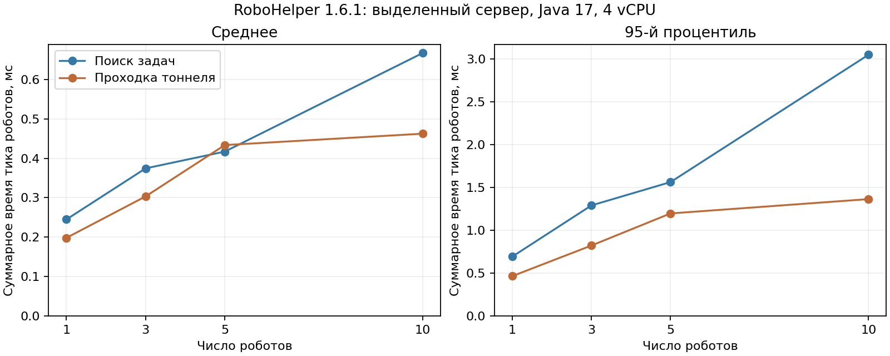
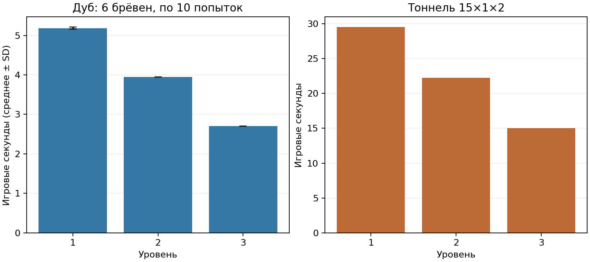
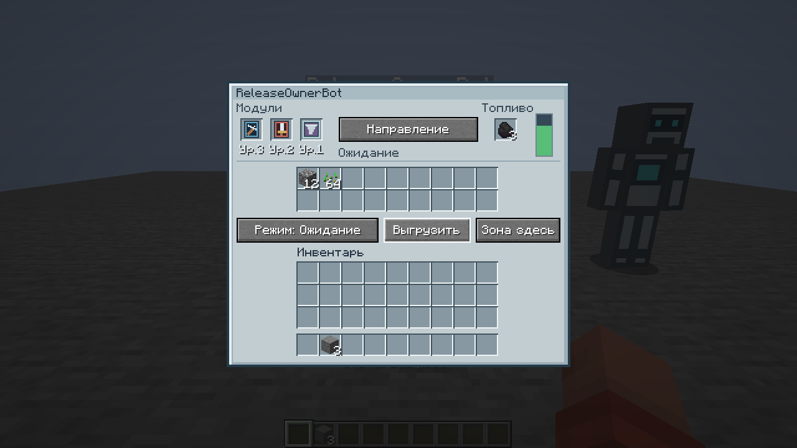
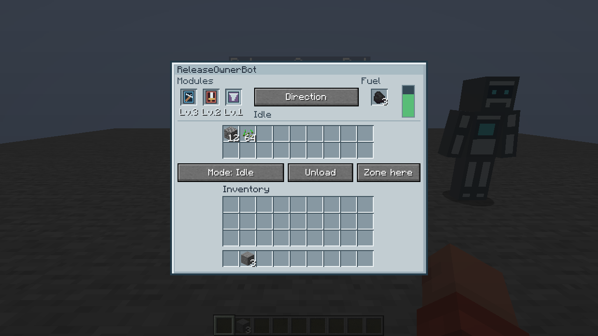

# Измерения RoboHelper 1.6.1

Сервер: Linux, Java 17.0.20.1, 4 vCPU. Дата: 16.11.2026.

Серверные проверки: **113/113**. Сетевая приёмка, полный перезапуск и чанки: пройдены.

## Нагрузка

Перед серией — 800 тиков общего прогрева на 10 роботах (поиск и работа). Затем для каждого случая — 60 тиков прогрева и 240 измеряемых тиков. Клиенты к этому моменту завершены. Порядок в каждой группе: 1, 3, 5, 10. Измеряется весь серверный `RobotEntity.tick`, а не только код профессии. Дополнительно записан полный серверный тик.

| Сценарий | Роботов | Среднее всего, мс | P95, мс | Максимум, мс | Полный серверный тик, среднее мс |
| --- | ---: | ---: | ---: | ---: | ---: |
| Поиск (лесоруб/фермер/логист) | 1 | 0.245 | 0.693 | 2.344 | 1.025 |
| Поиск (лесоруб/фермер/логист) | 3 | 0.374 | 1.290 | 3.590 | 1.437 |
| Поиск (лесоруб/фермер/логист) | 5 | 0.417 | 1.563 | 3.868 | 1.327 |
| Поиск (лесоруб/фермер/логист) | 10 | 0.667 | 3.050 | 6.133 | 1.457 |
| Шахтёр + охранник + логист | 1 | 0.198 | 0.465 | 8.872 | 0.999 |
| Шахтёр + охранник + логист | 3 | 0.303 | 0.822 | 4.692 | 1.262 |
| Шахтёр + охранник + логист | 5 | 0.433 | 1.197 | 9.921 | 1.483 |
| Шахтёр + охранник + логист | 10 | 0.462 | 1.364 | 2.510 | 1.492 |

Средние значения для одного робота ≤1 мс, суммарно для пяти ≤5 мс: требования НТ-04 выполнены в этих сценариях. P95 и максимумы не скрываются: порог ТЗ относится к среднему. JIT, GC и кэши влияют на сравнение, линейная зависимость нагрузки от числа роботов не утверждается. Это короткие контролируемые измерения, а не гарантия для любого ПК, большого мира или сборки модов.

Поиск: три установленных модуля, доступная зона без подходящих целей. Работа: реальные тоннели и добыча; охранник продолжает сканировать, логист установлен, но хранилище не достигает порога. Одновременный бой/выгрузка и активные фермы не входят в нагрузочную серию; их функциональная совместимость проверена GameTests.

## Баланс

| Уровень | Дуб: среднее до 6-го бревна, с | Полный цикл дуба: энергия | Тоннель 15 м: с | Энергия тоннеля (действия + ходьба) |
| --- | ---: | ---: | ---: | ---: |
| 1 | 5.185 | 130 | 29.50 | 753 (750 + 3) |
| 2 | 3.950 | 117 | 22.25 | 693 (690 + 3) |
| 3 | 2.700 | 104 | 15.00 | 603 (600 + 3) |

Дуб — искусственно подготовленный ствол из шести брёвен с непостоянной листвой, рядом с роботом, по 10 попыток каждого уровня. Время от выдачи задания включает начало поиска; энергия полного цикла включает посадку. Тоннель 15×1×2 — по одной проходке каждого уровня. Времена переведены из игровых тиков при 20 TPS, независимо от скорости ускоренного GameTest.

Поле **9×9**: 80 спелых культур и одна клетка воды, 160 действий. Время — **159.1 с**, энергия — **1946** (1940 действия + 6 ходьба). Робот начал на уровне 1 и достиг уровня 2 в середине работы; скидка уже включена. Все культуры пересажены, farmland сохранён. Рост культур отключён на время замера.

## Интерфейс настоящих клиентов

Скриншоты получены через framebuffer Minecraft в сетевом мире, без монтажа. Предметы и свойства синхронизированы с сервера.

## Ограничения

OpenAL в облачной среде не открыл аудиоустройство, поэтому слышимость игровых звуков не подтверждена. Не выполнены длительное ручное прохождение, вход через Microsoft/Mojang и тесты со сторонними модами. Подробности и матрица Т-01…Т-28: [VALIDATION.md](../../VALIDATION.md).
